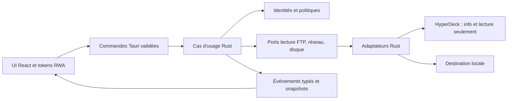

# Proposition d'architecture Rust V2

10 novembre 2026 — proposition à valider, fondée sur [l'audit HMP 1.1.0](RUST_MIGRATION_AUDIT.md). Aucun workspace Rust ni nouvelle dépendance n'est créé dans cette mission.

## Recommandation

Retenir **Rust + Tauri 2 + React/TypeScript/Vite**, avec un moteur d'offload Rust indépendant de Tauri. La raison décisive est la fidélité à la charte CSS réelle de Resolve Workflow Assistant et la continuité avec le frontend web existant. egui reste crédible pour un outil entièrement Rust ; il impose ici de réécrire toutes les primitives graphiques et leurs interactions sans réutiliser le CSS de référence. Le choix final reste conditionné à un prototype FTP legacy et à la validation utilisateur.

Cette proposition conserve une UI web : « migrer vers Rust » signifie déplacer le métier, le réseau et le disque en Rust, pas supprimer TypeScript. Si une application intégralement Rust est exigée, choisir egui après réévaluation du coût visuel.

## Comparaison appliquée à HMP

Les appréciations ci-dessous sont des déductions d'architecture, pas des benchmarks. Les deux options peuvent utiliser le même cœur Rust et le même adaptateur FTP.

| Critère | Rust + Tauri 2 | Rust + egui/eframe |
| --- | --- | --- |
| Performances transfert | Flux backend Rust ; ne pas passer les médias dans IPC | Même moteur Rust ; aucun avantage de débit inhérent à la GUI |
| Mémoire | WebView OS et DOM ; moins de runtime embarqué qu'Electron, RSS à mesurer | Pas de WebView ; allocations UI, textures et backend GPU, RSS à mesurer |
| CPU / fluidité | Limiter événements IPC et rendu des tables ; réseau/hash hors UI | Limiter repaint, tableaux visibles uniquement ; réseau/hash hors thread graphique |
| Migration | Nouvelle coque/bridge ; React/Vite et contrats métiers peuvent être adaptés progressivement | Réécriture complète du renderer, de la navigation et des composants |
| Fidélité RWA | Réutilisation des tokens CSS et traduction ciblée des composants | Recréation manuelle des couleurs, métriques, typographie, focus et widgets |
| Qualité graphique | CSS Grid, typographie, listes denses et accessibilité DOM | UI dessinée personnalisable, tableaux et panneaux possibles ; widgets système non automatiques |
| Maintenabilité | Rust + TypeScript, frontière IPC à maintenir ; compétences existantes réutilisées | Une langue, mais composants personnalisés et évolutions API GUI à maintenir |
| macOS / Windows | WKWebView / WebView2 ; tester les différences CSS, DPI et événements | eframe gère la fenêtre et le rendu ; tester GPU, DPI, IME et accessibilité |
| Réseau / FTP | Backend indépendant, autorisations Tauri au niveau bridge | Même backend indépendant, pas de bridge web |
| Gros fichiers | Lecture/écriture en flux, mémoire bornée ; UI reçoit seulement compteurs | Identique ; ne jamais charger un média complet dans l'état UI |
| Progression temps réel | Channel/event typé, agrégation et snapshot initial | Canal Rust vers état UI, réveil explicite de repaint |
| Packaging | Outillage de bundles intégré ; dépendance WebView2 Windows à prendre en compte | Exécutable natif puis choix/maintenance d'un outillage de bundle/installateur |
| Distribution | Signature/notarisation et installateurs par OS restent nécessaires | Mêmes obligations de distribution, à intégrer au pipeline choisi |
| Tests UI | DOM testable, mais browser ≠ WebView native ; WebDriver macOS limité | Tests métier identiques ; interactions et capture GPU à organiser |
| Risque dominant HMP | Compatibilité FTP + séparation bridge + variations WebView | Compatibilité FTP + coût de refonte visuelle complète |

Sources officielles consultées le 10 novembre 2026 : Tauri utilise des WebViews système et fournit l'outillage de distribution ; eframe intègre egui pour une UI dessinée et personnalisable. Voir [architecture Tauri](https://v2.tauri.app/concept/architecture/), [distribution Tauri](https://v2.tauri.app/distribute/), [eframe](https://docs.rs/eframe/latest/eframe/) et [egui](https://docs.rs/egui/latest/egui/). Ces documents établissent les capacités des frameworks, pas leur compatibilité avec un HyperDeck 2017.

## Architecture cible, indépendante de l'UI

Organisation proposée sous `v2/` uniquement après validation :

```text
v2/
  Cargo.toml                   # workspace V2 distinct de la racine Electron
  Cargo.lock
  crates/
    hmp-domain/                # identités, chemins FTP, états, politiques
    hmp-core/                  # cas d'usage, planification, vérification
    hmp-infra/                 # découverte TCP, FTP legacy, disque, réglages
    hmp-contract/              # DTO sérialisés, versions et erreurs publiques
  desktop/
    src/                       # React + charte HMP dérivée de RWA
    src-tauri/                 # commandes/capabilities, assemblage des services
  tests/fixtures/              # dialogues FTP et listings anonymisés
```

`hmp-domain` ne dépend ni d'Electron, ni de Tauri, ni d'egui. `hmp-core` dépend de ports étroits (découverte, lecture FTP, stockage, journal, horloge), implémentés par `hmp-infra`. `hmp-contract` stabilise la frontière UI sans exposer les types internes de la bibliothèque FTP. Le bootstrap desktop assemble ces éléments. Des tests et un harness de compatibilité peuvent instancier le moteur sans fenêtre.



## Contrats et invariants

- `RecorderId` stable distinct d'IP/nom ; `RemotePath` validé utilisant `/` ; `PathBuf` réservé au disque local. Identité média : recorder + chemin brut, pas un UUID recréé à chaque listing. Préserver la valeur d'origine séparée du libellé affiché.
- Ports FTP limités à connexion, listing, lecture et fermeture/annulation. Aucune méthode upload/delete/rename distant ni commande réseau arbitraire exposée au frontend. Découverte : `ping`, `device info` seulement, sans transport.
- `enqueue(selection, options)` fige recorder, destination, politique doublon et checksum pour le lot. Réservation exclusive des destinations avant départ pour empêcher les courses. Choix utilisateur explicite pour toute politique nouvelle.
- État par fichier : pending → running → verifying → verified ; sans checksum : running → done. Branches skipped/error/checksum-error/cancelled. Une annulation terminale ne peut plus devenir verified. La pause bloque les départs et laisse finir les jobs actifs, conformément à V1.
- Taille/distances en `u64` côté Rust ; sérialiser les compteurs en décimal si nécessaire pour ne pas dépasser la précision entière JS. Progression inconnue reste indéterminée, copie et vérification ont des phases distinctes.
- Avant finalisation : vérifier taille attendue si connue, fin de réponse FTP et hash local comparé au flux si activé. Écriture proposée dans un fichier temporaire sur le même volume, puis finalisation ; aucune promesse d'atomicité entre volumes.
- Distinguer `skippedExistingSameSize`, `copiedWithoutHash`, `verifiedAgainstTransferStream` ; ne jamais déduire une vérification distante d'une égalité de tailles. La simulation ne génère pas de preuve d'intégrité réelle.
- La fermeture de session et l'annulation doivent être idempotentes ; timeout, socket, lecture, écriture et relecture hash partagent le même signal. Traiter le résultat final FTP après EOF, pas uniquement la fin du flux de données.

## Flux réseau, concurrence et progression

Proposer Tokio pour les I/O et un ordonnanceur unique avec sémaphores globaux et par recorder. Commencer avec les paramètres V1 (deux transferts, un transfert réseau par recorder si option activée), puis mesurer. La vérification locale peut être bornée séparément pour éviter de saturer le disque. Hash en tâches bloquantes bornées ou workers dédiés ; aucune attente disque/réseau sur le thread UI.

Découverte : conserver IPv4 privé, limite de 254 hôtes, statuts inconnu/confirmé/FTP indisponible et ajout manuel. Utiliser l'adresse de l'interface comme bind quand pertinent, en vérifiant route et comportement Windows/macOS. Un recorder FTP accessible mais non confirmé sur 9993 reste ajoutable manuellement.

Émettre des changements par job et un snapshot à l'abonnement/reconnexion. Proposition : agrégation de progression à 5–10 Hz maximum par job, événements terminaux immédiats, buffers bornés. Le frontend ne reçoit ni paquets FTP ni octets de médias. Avec Tauri, utiliser un channel pour la progression d'une opération ; les événements globaux restent peu volumineux. Cette stratégie suit les [mécanismes Rust → frontend](https://v2.tauri.app/develop/calling-frontend/) ; la fréquence est un choix HMP à mesurer.

Erreurs publiques structurées : code (`authentication`, `timeout`, `listing`, `destination-full`, `permission`, `checksum`, `cancelled`), contexte recorder/chemin, message opérateur et détails repliables sans mot de passe. Préserver le code FTP exact pour décider les fallbacks ; éviter de ne comparer que du texte localisé.

## Dépendances candidates, à éprouver avant de figer

| Besoin | Candidat | Condition d'adoption |
| --- | --- | --- |
| Runtime / annulation | tokio, tokio-util | Version stable et features minimales dans Cargo.lock ; tâches bornées |
| FTP | suppaftp | Prouver LIST -a/LIST, CWD, login legacy, passif, fin RETR et annulation sur corpus puis matériel |
| Sérialisation / erreurs | serde, serde_json, thiserror | DTO versionnés et validation d'entrée, pas de types FTP en API UI |
| Hash | sha2 et md-5 | Streaming, relecture annulable et benchmark gros média ; conserver MD5 pour compatibilité, pas pour sécurité |
| Journal | tracing / tracing-subscriber | Rotation et suppression des secrets ; aucune télémétrie |
| Paramètres / destinations | APIs Rust + dialogue Tauri | Répertoire V2 dédié et confinement local validé |
| UI | React, Vite, API Tauri 2, plugin-dialog | Conserver le socle connu, versions exactes au prototype |
| Persistance rapports | JSON versionné initialement | SQLite seulement si besoin de queue durable/recherche approuvé |

[SuppaFTP](https://docs.rs/suppaftp/latest/suppaftp/) documente des flux et des variantes async ; cela n'établit aucune parité avec basic-ftp. Vérifier la version exacte et ses features au lot FTP ; les exemples de documentation peuvent viser une version antérieure. Ne pas écrire un nouveau client FTP complet par défaut : si le candidat échoue, comparer un adaptateur alternatif ou une correction limitée sur la base de traces. Vérifier licences et dépendances transitives avant intégration.

## Isolation, sécurité et développement

Electron reste à la racine avec ses scripts inchangés. V2 possède son package, son lockfile, ses sorties et son identifiant `fr.tktprod.hyperdeck-media-puller.v2.preview` proposé. Répertoire de données V2 distinct ; aucune écriture dans userData V1. Import V1 ultérieur par copie validée, sans modifier l'original ni ses secrets. Destination des essais distincte ; éviter deux applications écrivant simultanément dans la même destination.

Dans Tauri, réduire les commandes exposées et [capabilities](https://v2.tauri.app/reference/acl/capability/) aux opérations nécessaires. Les validations métier restent obligatoires côté Rust même si la permission est accordée. Frontend local embarqué, CSP, pas de shell générique ni d'accès arbitraire au filesystem depuis JS. Étudier le trousseau macOS/gestionnaire d'identifiants Windows pour les mots de passe, sans l'imposer silencieusement à l'import.

## Packaging et protocole de mesure

Après validation seulement : builds natifs macOS (Apple Silicon et Intel si retenu) et Windows x64 ; politique ARM Windows et versions minimales OS à décider. Préparer installateurs Windows et bundle/DMG macOS ; vérifier installation, désinstallation et coexistence V1/V2. Le mode portable V1 n'a pas d'équivalent garanti par le seul choix de Tauri : tester un livrable autonome et la disponibilité de WebView2, ou valider l'abandon de cette forme. Signature Windows, identité Apple et notarisation dépendent des comptes de distribution.

Les [prérequis Tauri](https://v2.tauri.app/start/prerequisites/) et le [guide de distribution](https://v2.tauri.app/distribute/) doivent être figés pour la version choisie. Ne pas présenter un build croisé comme une validation native. La [documentation WebDriver](https://v2.tauri.app/develop/tests/webdriver/) indique l'absence de driver desktop macOS : prévoir tests DOM en navigateur et validation native macOS distincte, sans prétendre qu'un test Chromium valide WKWebView.

Mesurer V1 et prototype sur les mêmes machines : mémoire totale des processus au repos/scan/copie, CPU, temps d'ouverture, débit d'un média >4 Gio puis plusieurs recorders, 10 000 entrées de listing et latence d'annulation. Fixer tailles des buffers et concurrence avant comparaison ; fournir médiane, dispersion et matériel. Objectif initial : mémoire de transfert bornée indépendamment de la taille du média, débit sans régression notable face à V1, interface réactive. Seuils chiffrés à fixer avec la référence mesurée ; aucun gain de performance n'est revendiqué aujourd'hui.
